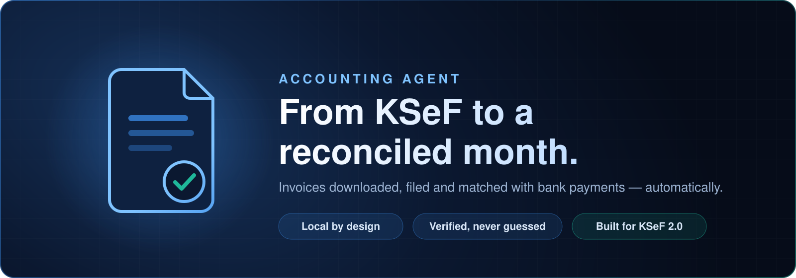
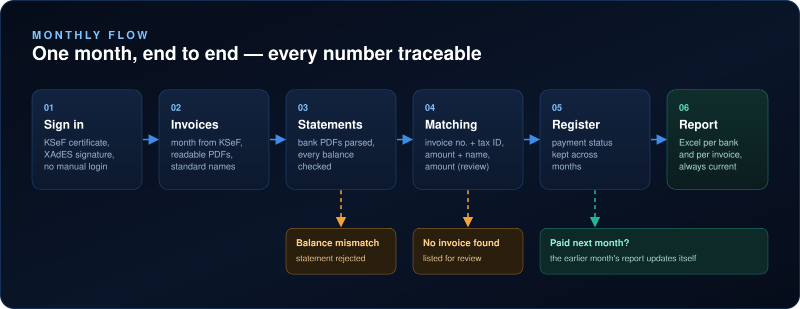
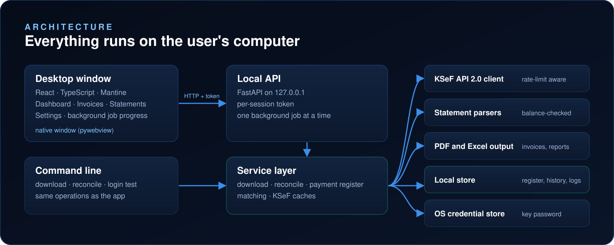

<h1 align="center">Accounting Agent</h1>

<p align="center">
  <strong>Download the invoices. Check the bank. Know what is paid.</strong><br />
  Fetches a month's purchase invoices from KSeF, files them as PDFs and reconciles them with bank statements.
</p>

<p align="center">
  
  
  
  
  
  
</p>

<p align="center">
  <a href="#why">Why</a> ·
  <a href="#flow">How it works</a> ·
  <a href="#architecture">Architecture</a> ·
  <a href="#quick-start">Quick start</a>
</p>

<a id="why"></a>
## Why Accounting Agent

| **01 / DOWNLOAD** | **02 / FILE** | **03 / RECONCILE** | **04 / CLOSE** |
| :---: | :---: | :---: | :---: |
| Every purchase invoice of the month, straight from KSeF. | A readable PDF for each invoice, with a consistent file name. | Bank statements read, balance-checked and matched with invoices. | One Excel report: what was paid, how, and what needs attention. |

Built for a single company and a non-technical user. Everything runs locally — the only outside connection is the one to KSeF.

> [!IMPORTANT]
> **Version 0.1.0.** Works on real data for Alior, Erste and UniCredit statements. The Windows installer is not code-signed yet, so Windows asks for confirmation before the first install.

<a id="flow"></a>
## How it works



- **Matching** goes from the strongest evidence to the weakest: invoice number and tax ID, amount and counterparty, amount alone (marked for review).
- **Payment register** keeps each invoice's status across months — a payment found next month updates the earlier report automatically.
- **Never guessed:** statements whose balances do not add up are rejected, each invoice is matched once, and cash payments are marked only by the user.

<a id="architecture"></a>
## Architecture



| Area | Technology |
| --- | --- |
| Backend | Python 3.14, uv, FastAPI |
| KSeF | httpx, signxml (XAdES), cryptography, lxml |
| Documents | fpdf2, pdfplumber, openpyxl |
| Desktop | pywebview, keyring |
| Frontend | React 19, TypeScript, Vite, Mantine |
| Packaging | PyInstaller, Inno Setup, GitHub Actions |

<a id="quick-start"></a>
## Quick start

### Windows

Download `Faktury-KSeF-Setup-<version>.exe` from [Releases](../../releases) and run it — no administrator rights needed. On first start, a setup wizard asks for the company tax ID, the KSeF certificate files and the key password, then tests the sign-in.

### From source

Requires [uv](https://docs.astral.sh/uv/), [Node.js](https://nodejs.org/) and a KSeF authentication certificate. The same commands work on macOS and in Windows PowerShell.

```bash
uv sync
npm --prefix frontend install
npm --prefix frontend run build

uv run ksef ustaw-haslo    # save the certificate key password
uv run ksef zaloguj        # test the KSeF sign-in
uv run faktury-ksef        # start the application
```

When running from source, configuration can come from a local `.env` file instead of the wizard: `KSEF_ENV` (`test`, `demo` or `prod`), `KSEF_NIP`, `KSEF_CERT_PATH` and `KSEF_KEY_PATH`.

| Purpose | Command |
| --- | --- |
| Download invoices of a month | `uv run ksef pobierz [month]` |
| Reconcile statements of a month | `uv run ksef porownaj [month]` |
| Tests and lint | `uv run pytest` · `uv run ruff check .` · `npm --prefix frontend run lint` |
| Release | push a tag `vX.Y.Z` — the installer is built, checked on Windows and published |

## Security

- The private key never leaves the computer; its password is kept in the system credential store.
- The local API accepts requests only from the application window.
- Certificates, statements, invoices and reports never enter the repository.

## Roadmap

UBS statements · AI-assisted cost analysis
