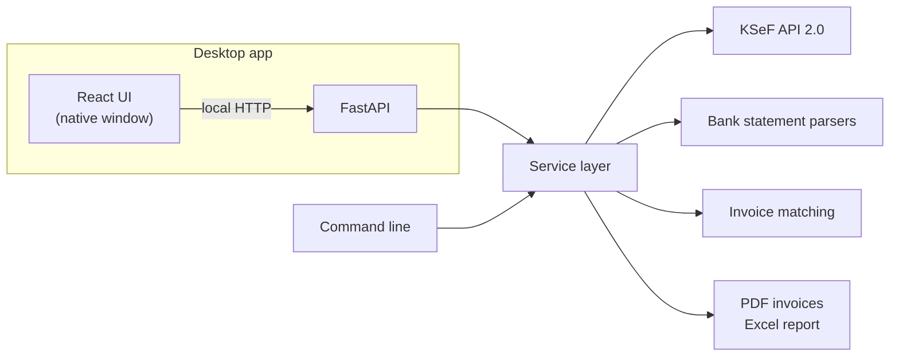

# Accounting Agent

Desktop application that automates monthly bookkeeping chores: it downloads purchase
invoices from **KSeF** (the Polish National e-Invoicing System), saves them as PDF files
and reconciles them against **bank statements**, producing an Excel report of what was
paid, how, and what is missing.

The application runs locally — documents, certificates and passwords never leave the
computer, except for the requests sent directly to KSeF.

---

## Features

### Invoices from KSeF
- Authenticates to KSeF API 2.0 with a KSeF certificate (XAdES signature).
- Downloads all purchase invoices issued in a selected month.
- Renders every invoice as a readable PDF: parties, line items, VAT summary, payment
  details, corrections.
- Saves files in a monthly folder structure with standardised file names.
- Skips invoices that were already downloaded and keeps a local copy of the invoice data,
  so repeated runs stay within KSeF rate limits.

### Bank statement reconciliation
- Reads PDF statements from several banks and verifies every statement against its
  balances before using it.
- Classifies debits: transfers, card payments, bank fees, deposits, taxes, salaries and more.
- Matches payments to invoices by invoice number and tax ID, by amount and counterparty,
  or by amount alone (flagged for review).
- Explains invoices without a matching payment using the payment data on the invoice itself.
- Produces an Excel report per bank account: matched debits, debits without an invoice and
  invoices without a payment.

### Desktop application
- Native window with a dashboard, invoice list, statement reconciliation and settings.
- Background jobs with progress, saved results and operation history.
- Clear error messages and a log file for diagnostics.

---

## How it works



The desktop app and the command line share the same service layer.

---

## Getting started

### Requirements
- [uv](https://docs.astral.sh/uv/) (installs Python and all Python dependencies)
- [Node.js](https://nodejs.org/) (to build the user interface)
- A KSeF authentication certificate for a person authorised to view the company's invoices

### Setup

```bash
uv sync
npm --prefix frontend install
npm --prefix frontend run build
```

Configure the company tax ID and the certificate in a local `.env` file, then store the
certificate key password in the operating system's credential store:

```bash
uv run ksef ustaw-haslo
uv run ksef zaloguj
```

### Run

```bash
uv run faktury-ksef
```

### Command line

| Command | Description |
|---|---|
| `uv run ksef pobierz <month>` | download purchase invoices of a month as PDF |
| `uv run ksef porownaj <month>` | reconcile bank statements of a month with invoices |
| `uv run ksef zaloguj` | test KSeF authentication |
| `uv run ksef ustaw-haslo` | save the certificate key password |

---

## Development

```bash
# backend with auto-reload
uv run uvicorn accounting_agent.api:dev_app --factory --port 8765 --reload --reload-dir src

# user interface with hot reload
npm --prefix frontend run dev
```

Quality checks:

```bash
uv run pytest
uv run ruff check .
npm --prefix frontend run lint
npm --prefix frontend run build
```

### Tech stack

| Area | Technology |
|---|---|
| Backend | Python, uv, FastAPI |
| KSeF | httpx, signxml (XAdES), cryptography, lxml |
| Documents | fpdf2, pdfplumber, openpyxl |
| Desktop | pywebview |
| Frontend | React, TypeScript, Vite, Mantine |

---

## Security

- Certificates, keys and local configuration are never committed.
- The certificate key password is kept in the operating system's credential store.
- Only signatures are sent to KSeF; the private key never leaves the computer.
- The local API accepts requests only from the application window.

---

## Roadmap

- First-run setup wizard
- Windows installer
- More bank statement formats
- AI-assisted features: cost categorisation, questions about expenses, anomaly detection
