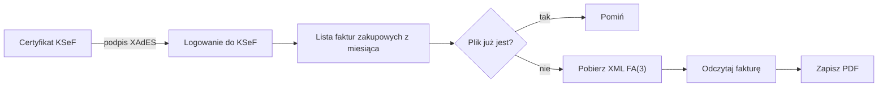

# Accounting Agent

**Faktury zakupowe z KSeF prosto do folderu, jako czytelne PDF-y z porządnymi nazwami.**

Accounting Agent loguje się do Krajowego Systemu e-Faktur certyfikatem firmy, pobiera
faktury zakupowe z wybranego miesiąca i zapisuje każdą z nich jako PDF. Bez klikania
w Aplikacji Podatnika, bez Profilu Zaufanego, bez ręcznego przepisywania nazw.

```
uv run ksef pobierz 2026-08
```

```
Faktur zakupowych w 2026-08: 17
  zapisano: 2026-08-08_INV F 13381K2-1024-26_Shell.pdf
  zapisano: 2026-08-09_INV 509417000826_T-Mobile.pdf
  zapisano: 2026-08-17_KOR 105-KOR-26-04_WSPÓLNOTA MIESZKANIOWA SOLEC 24.pdf
  zapisano: 2026-08-24_INV 26KPF01191_WARDYŃSKI I WSPÓLNICY.pdf
  ...
```

---

## Co potrafi

- **Logowanie certyfikatem KSeF** – podpis XAdES zgodny z API KSeF 2.0, bez udziału człowieka.
- **Faktury z całego miesiąca** – wszystkie faktury, w których firma jest nabywcą,
  według daty wystawienia.
- **Czytelne PDF-y** – sprzedawca, nabywca, pozycje, podsumowanie VAT, płatność, korekty
  i uwagi wystawcy, z polskimi znakami.
- **Nazwy, które da się czytać** – data, numer i krótka nazwa sprzedawcy.
- **Bez duplikatów** – pliki, które już są na dysku, są pomijane bez ponownego pobierania.
- **Szacunek dla limitów KSeF** – spokojne tempo pobierania i automatyczne czekanie,
  gdy serwer o to poprosi.
- **macOS i Windows** – ten sam kod, ta sama konfiguracja.

## Jak nazywane są pliki

```
2026-08-08_INV F 13381K2-1024-26_Shell.pdf
└───┬────┘ └┬┘ └───────┬───────┘ └─┬─┘
    │       │          │           └─ sprzedawca, bez formy prawnej i dopisku „Polska”
    │       │          └─ numer faktury („/” zamienione na „-”)
    │       └─ INV, a dla faktur korygujących KOR
    └─ data wystawienia
```

## Jak to działa



Oryginałem faktury jest zawsze plik XML w KSeF. PDF to jego wizualizacja – wygodna
do przeglądania, archiwizacji i przekazania dalej.

## Pierwsze uruchomienie

Potrzebny jest [uv](https://docs.astral.sh/uv/) – sam zainstaluje właściwą wersję Pythona
i wszystkie biblioteki.

```
uv sync
```

Certyfikat KSeF typu **„Uwierzytelnienie w systemie KSeF”** (plik `.crt` i klucz `.key`)
trafia do folderu `certs/`. W katalogu projektu tworzysz plik `.env`:

```
KSEF_ENV=prod
KSEF_NIP=<NIP firmy>
KSEF_CERT_PATH=certs/<nazwa>.crt
KSEF_KEY_PATH=certs/<nazwa>.key
OUTPUT_DIR=<folder na faktury>
```

Hasło do klucza nie leży w żadnym pliku – trafia do systemowego sejfu
(Pęk kluczy w macOS, Menedżer poświadczeń w Windows):

```
uv run ksef ustaw-haslo
uv run ksef zaloguj
```

## Komendy

| Komenda | Co robi |
|---|---|
| `uv run ksef pobierz 2026-08` | pobiera faktury zakupowe z sierpnia 2026 do `OUTPUT_DIR` |
| `uv run ksef zaloguj` | sprawdza, czy logowanie do KSeF działa |
| `uv run ksef ustaw-haslo` | zapisuje hasło do klucza certyfikatu w sejfie systemu |

## Bezpieczeństwo

- Certyfikat, klucz i `.env` nigdy nie trafiają do repozytorium.
- Klucz prywatny jest zaszyfrowany, a hasło do niego przechowuje system operacyjny.
- Do KSeF trafia wyłącznie podpis – klucz prywatny nie opuszcza komputera.
- Sesja w KSeF jest zamykana zaraz po pobraniu faktur.

## Pod maską

| | |
|---|---|
| Język | Python 3.14, zarządzany przez uv |
| KSeF | własny klient API 2.0 (`httpx`), podpis XAdES (`signxml`) |
| Faktury | odczyt schematu FA(3) (`lxml`) |
| PDF | `fpdf2` z systemową czcionką Arial |
| Sekrety | `keyring` |

```
src/accounting_agent/
├── cli.py          komendy ksef …
├── config.py       konfiguracja z .env
├── credentials.py  hasło w sejfie systemu, klucz prywatny
├── ksef.py         klient API KSeF 2.0
├── invoice.py      odczyt faktury FA(3)
├── naming.py       nazwy plików
└── pdf.py          wizualizacja PDF
```

## Co dalej

- Docelowa struktura folderów na faktury.
- Instalacja na komputerze z Windows dla osoby, która nie jest programistą.
- Agent AI: kategoryzacja kosztów, opisy i przygotowanie danych dla księgowości.
